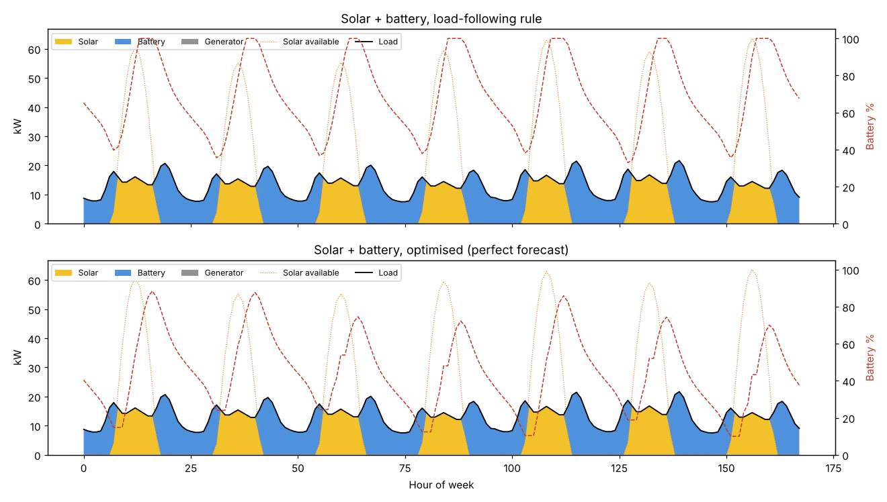

# Solar + battery dispatch simulator

Simulates a year, hour by hour, of a site that runs on solar, batteries and a diesel generator, and works out how much diesel each way of running it burns. Built for Botswana sites: safari camps, farms and mines. Idea #38 from [frontier-research](https://github.com/mehdiacho/frontier-research).

The first scenario is a **10-tent camp in the Okavango Delta** that runs on diesel today.



## What it answers

1. **How much diesel would solar and a battery save?** Diesel only, then solar with no battery, then solar plus battery.
2. **Does the control logic matter?** Two common controller rules (load-following, cycle-charging) against an optimiser with a perfect forecast, which is the best any controller could do.
3. **What size should they buy?** A sweep over solar and battery sizes, showing diesel use and payback.

## First result (every input is an assumption; see below)

10-tent Delta camp, about 293 kWh/day, 40 kW generator, 100 kWp solar, 300 kWh battery, diesel at P23.76/L:

| | Diesel (L/yr) | Running cost (P/yr) | Solar share |
|---|---:|---:|---:|
| Diesel only (today) | 57,800 | 1,373,000 | 0% |
| Solar + diesel, no battery | 34,100 | 813,000 | 35% |
| Solar + battery, load-following rule | 470 | 43,000 | 99% |
| Solar + battery, cycle-charging rule | 680 | 48,000 | 98% |
| Solar + battery, optimised | 330 | 40,000 | 99% |

What it says so far:
- **The battery is what removes the diesel.** Solar alone saves about 40%, because much of the camp's load comes after dark.
- **At this size, the control logic changes little** (P3,000–8,000 a year). Sizing matters far more. Control matters more on smaller systems and on grid-tied sites with tariffs.
- **A battery with no solar still saves about 10%,** because the generator no longer idles at low load.
- **These numbers are as good as their inputs.** The load, solar, prices and capex are placeholders, and the solar model is probably too sunny. Don't quote the 1.6-year payback until real site data is in.

Full table: [`docs/first-run/summary.md`](docs/first-run/summary.md). Size sweep: [`docs/first-run/sweep-diesel.png`](docs/first-run/sweep-diesel.png).

## Run it

Python 3.11 or newer.

```sh
python -m venv .venv
.venv/Scripts/pip install -r requirements.txt     # Windows; .venv/bin/pip elsewhere
.venv/Scripts/python -m pytest -q
.venv/Scripts/python -m dispatch run scenarios/delta-camp.toml      # report + charts in results/delta-camp/
.venv/Scripts/python -m dispatch run scenarios/delta-camp.toml --fast   # skip the optimiser
.venv/Scripts/python -m dispatch sweep scenarios/delta-camp.toml    # sizes grid
```

A full run takes about 10 seconds; the optimiser solves 365 small problems with HiGHS (inside SciPy).

Make a new site by copying `scenarios/delta-camp.toml` and changing it. For real solar data, run `python scripts/fetch_pvgis.py scenarios/<site>.toml` once (a small download from PVGIS). For a real load, put an 8760-row CSV with a `load_kw` column next to the scenario and set `load.csv`.

## How it works

| Part | File | Notes |
|---|---|---|
| Solar | `dispatch/solar.py` | Sun position + clear-sky model, scaled to the annual total, with wet-season cloud and runs of overcast days. Uses PVGIS data instead when fetched. |
| Load | `dispatch/load.py` | Always-on base + guest energy × hourly shape × monthly occupancy × cooling. Or a meter CSV. |
| Generator, battery | `dispatch/components.py` | Fuel curve (no-load + per-kWh), minimum load; battery efficiency, limits, wear cost per kWh moved. |
| Strategies | `dispatch/strategies.py` | Load-following and cycle-charging rules; MILP optimiser over a rolling 48 h window. |
| Report | `dispatch/run.py`, `dispatch/metrics.py` | Diesel, cost, solar share, generator hours and starts, cycles, CO2, payback, charts. |

Assumptions and sources: [`docs/assumptions.md`](docs/assumptions.md). State and next steps: [`docs/HANDOFF.md`](docs/HANDOFF.md).
