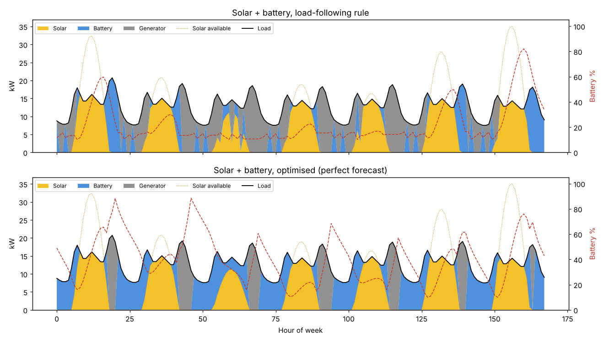

# Solar + battery dispatch simulator

Simulates a year, hour by hour, of a site that runs on solar, batteries and a diesel generator, and works out how much diesel each way of running it burns. Built for Botswana sites: safari camps, farms and mines. Idea #38 from [frontier-research](https://github.com/mehdiacho/frontier-research).

The first scenario is a **10-tent camp in the Okavango Delta** that runs on diesel today.



## What it answers

1. **How much diesel would solar and a battery save?** Diesel only, then solar with no battery, then solar plus battery.
2. **Does the control logic matter?** Two common controller rules (load-following, cycle-charging) against an optimiser with a perfect forecast, which is the best any controller could do.
3. **What size should they buy?** A sweep over solar and battery sizes, showing diesel use and payback.

## Latest result

10-tent Delta camp. **Solar:** real PVGIS data for the site (2,169 kWh/m² a year). **System:** the size of a real Delta camp install, 55 kWp solar and 195 kWh lithium. **Load:** about 293 kWh/day (still an assumption). 40 kW generator, diesel at P23.76/L.

| | Diesel (L/yr) | Running cost (P/yr) | Solar share | Generator starts |
|---|---:|---:|---:|---:|
| Diesel only (today) | 57,800 | 1,373,000 | 0% | 1 |
| Solar + diesel, no battery | 37,000 | 882,000 | 30% | 358 |
| Solar + battery, load-following rule | 9,900 | 264,000 | 81% | 597 |
| Solar + battery, cycle-charging rule | 12,700 | 332,000 | 64% | 220 |
| Solar + battery, optimised | 7,000 | 196,000 | 81% | 267 |

What it says so far:
- **Solar plus a battery cuts diesel by 78–88%, depending on the control.** Solar alone cuts it by about a third, because much of a camp's load comes after dark.
- **At a real camp's size, smarter control is worth about 2,900 L a year** (about P68,000) over the usual load-following rule: 29% less diesel and fewer than half the starts. The rule flicks the generator on and off at low load; the optimiser runs it in the evening peak, at a better load, and charges the battery at the same time (chart above).
- **The cycle-charging rule is the worst choice here.** It fills the battery with generator power and leaves no room for the next day's sun.
- **Twice the solar and battery (about 100 kWp and 300 kWh) would take this camp to under 400 L a year.** Size sweep: [`docs/results/sweep-diesel.png`](docs/results/sweep-diesel.png).
- **The money is still rough.** The load, delivered diesel price and installed costs are placeholders, so don't quote the 1–2-year paybacks yet.

The optimiser's gain is an upper bound: it knows the weather ahead. Milestone M5 measures how much a real forecast keeps.

Full table: [`docs/results/summary.md`](docs/results/summary.md).

## Run it

Python 3.11 or newer.

```sh
python -m venv .venv
.venv/Scripts/pip install -r requirements.txt     # Windows; .venv/bin/pip elsewhere
.venv/Scripts/python -m pytest -q
.venv/Scripts/python -m dispatch run scenarios/delta-camp.toml      # report + charts in results/delta-camp/
.venv/Scripts/python -m dispatch run scenarios/delta-camp.toml --fast   # skip the optimiser
.venv/Scripts/python -m dispatch sweep scenarios/delta-camp.toml    # sizes grid
```

A full run takes about 10 seconds; the optimiser solves 365 small problems with HiGHS (inside SciPy).

Make a new site by copying `scenarios/delta-camp.toml` and changing it. For real solar data, run `python scripts/fetch_pvgis.py scenarios/<site>.toml` once (a small download from PVGIS); it writes hourly data to `scenarios/data/`. The Delta camp already has PVGIS daily totals there. For a real load, put an 8760-row CSV with a `load_kw` column next to the scenario and set `load.csv`.

## How it works

| Part | File | Notes |
|---|---|---|
| Solar | `dispatch/solar.py` | PVGIS data from `scenarios/data/` (hourly, or daily totals spread with the clear-sky shape). Falls back to a clear-sky model with wet-season cloud and runs of overcast days. |
| Load | `dispatch/load.py` | Always-on base + guest energy × hourly shape × monthly occupancy × cooling. Or a meter CSV. |
| Generator, battery | `dispatch/components.py` | Fuel curve (no-load + per-kWh), minimum load; battery efficiency, limits, wear cost per kWh moved. |
| Strategies | `dispatch/strategies.py` | Load-following and cycle-charging rules; MILP optimiser over a rolling 48 h window. |
| Report | `dispatch/run.py`, `dispatch/metrics.py` | Diesel, cost, solar share, generator hours and starts, cycles, CO2, payback, charts. |

Assumptions and sources: [`docs/assumptions.md`](docs/assumptions.md). State and next steps: [`docs/HANDOFF.md`](docs/HANDOFF.md).
